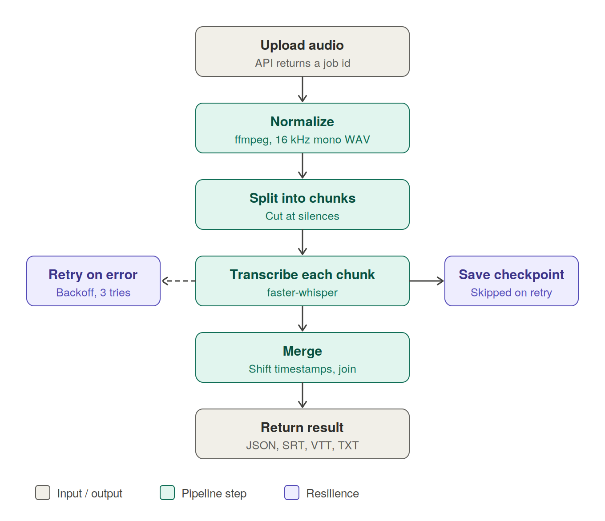
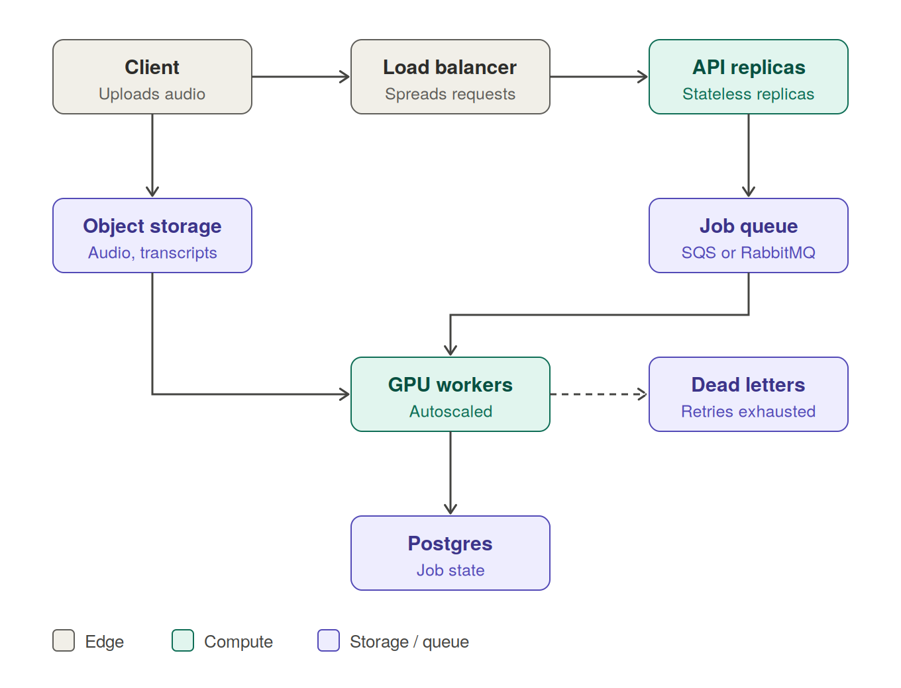

# Transcription Pipeline

A small, production-minded service that turns an audio file into text with **per-segment timestamps**, and prepares the result for downstream use (JSON, SRT, VTT, plain text).

- **Engine:** [faster-whisper](https://github.com/SYSTRAN/faster-whisper), an open-source Whisper implementation that runs locally on CPU or GPU
- **Audio handling:** ffmpeg normalizes every input format and finds silence points for chunking
- **Interfaces:** a CLI script and an asynchronous REST API (FastAPI)
- **Reliability:** checkpointed chunks, retries with backoff, crash recovery
- **Testable:** a mock STT backend lets the full pipeline be tested without downloading a model

> The assignment focuses on engineering decisions, not model training. Most of the effort here goes into format handling, long-audio strategy, failure recovery and API design.

---

## Table of contents

1. [How it works](#how-it-works)
2. [Quick start](#quick-start)
3. [Usage](#usage)
4. [Output format](#output-format)
5. [Project structure](#project-structure)
6. [Part 1: Design decisions](#part-1-design-decisions)
7. [Part 2: System design](#part-2-system-design)
8. [Testing](#testing)
9. [Limitations and next steps](#limitations-and-next-steps)

---

## How it works



1. **Upload.** The API streams the file to disk, creates a job and immediately returns `202` with a job id.
2. **Normalize.** ffmpeg converts any input to 16 kHz mono WAV, the format Whisper expects.
3. **Split.** Short files are processed whole. Long files are split into ~5 minute chunks, cutting at the silence nearest each boundary so words are not sliced in half.
4. **Transcribe.** Each chunk goes through faster-whisper. Its timestamps are shifted by the chunk's start time so they match the original file. The result is saved as a checkpoint.
5. **Retry.** Transient errors are retried with exponential backoff. Finished chunks are never redone.
6. **Merge and return.** Segments are joined in order, numbered, and served as JSON, SRT, VTT or text.

---

## Quick start

### Prerequisites

- Python 3.10 or newer
- ffmpeg and ffprobe available on your `PATH`

| OS | Install ffmpeg |
|---|---|
| Windows | `winget install ffmpeg` (then restart the terminal) |
| macOS | `brew install ffmpeg` |
| Ubuntu / WSL | `sudo apt install ffmpeg` |

Check with `ffmpeg -version`.

### Install

```bash
python -m venv .venv
source .venv/bin/activate          # Windows: .venv\Scripts\activate
pip install -r requirements.txt
```

### Verify

```bash
pytest -q                          # 9 tests, uses the mock backend, no model download
```

### Docker (optional)

```bash
docker build -t transcriber .
docker run -p 8000:8000 -v $(pwd)/data:/data transcriber
```

---

## Usage

### CLI

```bash
python cli.py meeting.mp3                         # JSON to stdout
python cli.py meeting.mp3 --format srt            # json | srt | vtt | txt
python cli.py meeting.mp3 --language en           # skip language detection
python cli.py meeting.mp3 --model small           # tiny | base | small | medium | large-v3
python cli.py meeting.mp3 --backend mock          # fake engine, no model download
python cli.py long.mp3 --workdir ./work           # keep checkpoints; a rerun resumes
```

The first real run downloads the Whisper model (about 150 MB for `base`).

### API

```bash
uvicorn app.api:app --port 8000
```

Interactive docs: <http://localhost:8000/docs>

```bash
# 1. Upload (returns immediately)
curl -F file=@meeting.mp3 localhost:8000/v1/transcriptions
# {"id":"3f9c...","status":"queued","status_url":"/v1/transcriptions/3f9c..."}

# 2. Poll status
curl localhost:8000/v1/transcriptions/3f9c...
# {"id":"3f9c...","filename":"meeting.mp3","status":"processing","attempts":1,"progress":"2/3","error":null}

# 3. Fetch the result
curl localhost:8000/v1/transcriptions/3f9c.../result
curl "localhost:8000/v1/transcriptions/3f9c.../result?format=srt"
```

| Method | Path | Purpose |
|---|---|---|
| `POST` | `/v1/transcriptions` | Multipart upload with optional `language`. Returns `202` and a job id. `413` if over the size limit. |
| `GET` | `/v1/transcriptions/{id}` | Status (`queued`, `processing`, `completed`, `failed`), attempts, progress, error. |
| `GET` | `/v1/transcriptions/{id}/result?format=json\|srt\|vtt\|txt` | The transcript. `409` if the job is not finished. |
| `POST` | `/v1/transcriptions/{id}/retry` | Re-run a failed job. Keeps existing checkpoints. |
| `GET` | `/healthz` | Liveness check. |

### Configuration

All settings are environment variables.

| Variable | Default | Meaning |
|---|---|---|
| `STT_BACKEND` | `whisper` | `whisper` or `mock` |
| `WHISPER_MODEL` | `base` | Model size. Larger is more accurate and slower. |
| `CHUNK_TARGET_S` | `300` | Target chunk length in seconds |
| `CHUNK_SEARCH_S` | `30` | Search window around each target cut for a silence |
| `MAX_WORKERS` | `2` | Jobs processed concurrently |
| `MAX_ATTEMPTS` | `3` | Tries before a job is marked failed |
| `MAX_UPLOAD_MB` | `200` | Upload size limit |
| `DATA_DIR` | `data` | Where uploads, work files and transcripts live |

---

## Output format

Timestamps are always relative to the start of the **original** file, even when the audio was processed in chunks.

```json
{
  "language": "en",
  "duration": 754.2,
  "chunks": 3,
  "text": "Hello everyone and welcome ...",
  "segments": [
    { "id": 0, "start": 0.0,  "end": 4.8, "text": "Hello everyone and welcome." },
    { "id": 1, "start": 4.8,  "end": 9.1, "text": "Today we are reviewing the roadmap." }
  ]
}
```

The same data renders as SRT, VTT or plain text:

```
1
00:00:00,000 --> 00:00:04,800
Hello everyone and welcome.
```

---

## Project structure

```
.
├── app/
│   ├── api.py           FastAPI endpoints and startup wiring
│   ├── worker.py        Thread pool, retries with backoff, crash recovery
│   ├── pipeline.py      Core flow: normalize, chunk, transcribe, checkpoint, merge
│   ├── audio.py         All ffmpeg work: decode, probe, silence detection, cutting
│   ├── transcriber.py   STT backends behind one interface (Whisper, mock)
│   ├── store.py         Job state in SQLite
│   ├── formats.py       JSON to SRT / VTT / text
│   ├── config.py        Environment-based settings
│   └── errors.py        Permanent vs transient error types
├── tests/               pytest suite (pipeline and API)
├── docs/                Diagrams used in this README
├── cli.py               Command-line entry point
├── Dockerfile
└── requirements.txt
```

---

## Part 1: Design decisions

### Speech-to-text engine

I used **faster-whisper**. It is open source, runs fully offline, has no per-minute cost, keeps audio on the machine (good for privacy), and runs well on CPU with int8 quantization. The engine sits behind a one-method `Transcriber` interface, so swapping in Deepgram, AssemblyAI or the OpenAI API means writing one class and changing nothing else. The same interface powers the mock backend used in tests.

### Handling different audio formats

I do not write per-format code. Every input is decoded by one ffmpeg command into **16 kHz mono PCM WAV**, which is also what Whisper uses internally. That covers mp3, m4a, ogg, flac, wav and even video containers, detected by content rather than file extension. If ffmpeg cannot decode a file, the pipeline raises `InvalidAudioError`, which is treated as **permanent** and is not retried. WAV and MP3 are covered by tests.

### Handling long audio

Processing a two-hour file in one call is risky: memory grows, there is no progress signal, and one failure loses everything. Instead:

- Files longer than about 5.5 minutes are split into **~5 minute chunks**.
- Each cut is snapped to the **silence closest to the target boundary** (ffmpeg `silencedetect`, within a 30 second window), so words are not cut in half. If no silence is nearby, it falls back to a hard cut.
- Each chunk's timestamps are **offset by its start time** before merging.
- Short files skip chunking entirely.
- Whisper's VAD filter is enabled to reduce made-up text over silence.

This gives bounded memory, progress reporting (`2/3`), a failure cost of one chunk instead of the whole file, and a clear path to parallel processing.

### Resumability

Each finished chunk is written to `chunk_N.json` using a temp file plus `os.replace`, which is atomic, so a crash can never leave a half-written checkpoint. A retry, a restart or a manual rerun skips every completed chunk. This is covered by a test that fails the third chunk and verifies the first two are not reprocessed.

### Error handling philosophy

| Error type | Example | Behavior |
|---|---|---|
| Permanent | Corrupt or non-audio file | Fail immediately, no retries |
| Transient | Model error, out of memory, I/O hiccup | Retry with exponential backoff (2s, 4s) up to `MAX_ATTEMPTS` |

---

## Part 2: System design

This section describes how I would take the project to production. The current code implements the single-machine version of the same design.



### Concurrent uploads

**Today:** the API streams each upload to disk in 1 MB pieces (constant memory), enforces a size limit, creates a job row, and returns `202` immediately. A bounded thread pool (`MAX_WORKERS`) processes jobs, so a burst of uploads queues up instead of overloading the machine.

**At scale:**
- Stateless API replicas behind a load balancer.
- Clients upload **directly to object storage** with presigned URLs, so audio bytes never pass through the API.
- A real queue (SQS, RabbitMQ or Redis Streams) replaces the in-process pool.
- GPU workers autoscale on queue depth.
- Per-tenant rate limits and priority queues stop one user from starving others.

### Storing audio and transcripts

Blobs and relational state are stored separately.

| Data | Store | Notes |
|---|---|---|
| Original audio | Object storage (S3 or GCS), `audio/{tenant}/{job_id}/original.ext` | Lifecycle rule to delete or archive after N days. Audio is large and often sensitive. |
| Transcripts | JSON in object storage, full text in Postgres (or OpenSearch if search is needed) | Immutable once written. |
| Job metadata | Postgres | Status, attempts, error, timestamps, owner. |

Encryption at rest, signed URLs for downloads, and tenant-scoped keys cover privacy. Locally the code uses disk and SQLite with the same split.

### Retrying and recovering failed transcriptions

**Implemented:**
- Errors are classified as permanent or transient (see the table above).
- Transient failures retry with exponential backoff; the error and attempt count are stored on the job.
- Chunk checkpoints mean retries resume rather than restart.
- On startup, any job still `queued` or `processing` is re-enqueued, which recovers from crashes.
- `POST /v1/transcriptions/{id}/retry` re-runs a failed job on demand.

**At scale:**
- Queue visibility timeouts and heartbeats, so a dead worker's job is redelivered.
- A dead-letter queue after N failures, with alerting.
- Idempotent job ids so redelivery cannot double-write.
- Metrics on failure rate by error type, queue age and processing speed relative to audio length.

### Exposing it as an API

The API is **asynchronous** because transcription takes minutes and a blocking request would time out. The endpoints are listed in the [API table](#api). Natural next steps:

- A webhook or callback URL on completion, instead of polling
- API-key or OAuth2 authentication with per-tenant quotas
- An `Idempotency-Key` header on uploads
- A list endpoint with pagination
- Presigned-URL uploads for very large files

---

## Testing

```bash
pytest -q
```

Nine tests run against the mock backend and need only ffmpeg. Test audio is generated on the fly (a tone with periodic silence, as both WAV and MP3).

| Area | What is verified |
|---|---|
| Chunk planning | Cuts snap to silence; chunks are contiguous; hard-cut fallback works |
| Formats | WAV and MP3 both transcribe; timestamps increase across chunks and end near the real duration; SRT and VTT are valid |
| Resume | After a mid-run failure, finished chunks are not reprocessed |
| Bad input | A corrupt file raises a permanent error |
| API | Four simultaneous uploads all complete; a bad file ends as `failed` after one attempt and its result returns `409`; a transient failure is retried and succeeds |

---

## Limitations and next steps

Known limitations, stated plainly:

- Silence-based chunking is a heuristic. Very noisy audio can force a hard cut that clips a word.
- Chunks within one job run sequentially.
- No speaker diarization and no word-level timestamps.
- Transcription accuracy was not benchmarked; the focus was the pipeline.
- The thread pool lives inside the API process, so it suits a single machine.

What I would do next, in order:

1. **Parallel chunk processing** across workers for the biggest speed gain on long files.
2. **Overlapping chunks** with de-duplication, to remove boundary risk completely.
3. **Real queue and separate worker processes** (see the system design above).
4. **Speaker diarization** and word-level timestamps.
5. **Accuracy evaluation** with word error rate against reference transcripts.
